# 🌌 Gauransh Bansal Labs — Interactive Physics & Computational Simulations

<p align="center">
  
</p>

<p align="center">
  <strong>A curated collection of client-side computational physics engines, generative ecosystems, numerical solvers, and interactive virtual laboratories.</strong><br>
  <em>Conceived, derived, and engineered by <strong><a href="https://www.linkedin.com/in/gauransh-bansal-a71223239/">Gauransh Bansal</a></strong> (M.Sc. Physics, University of Delhi).</em>
</p>

<p align="center">
  <a href="index.html"></a>
  
  
  
  
</p>

<p align="center">
  <a href="#-featured-laboratory-spotlight"><strong>✨ Featured Lab (LUMOS)</strong></a> &nbsp;•&nbsp;
  <a href="#-visual-catalog--laboratory-matrix"><strong>🧪 The 13 Laboratories</strong></a> &nbsp;•&nbsp;
  <a href="#-the-story--development-philosophy"><strong>📖 Philosophy & Methodology</strong></a> &nbsp;•&nbsp;
  <a href="#%EF%B8%8F-computational-architecture--tech-stack"><strong>⚙️ Architecture & Engines</strong></a> &nbsp;•&nbsp;
  <a href="#-about-the-author--connect"><strong>👤 Author & Connect</strong></a>
</p>

---

## ✨ Featured Laboratory Spotlight

<p align="center">
  <a href="lumos_molecular_spectroscopy.html">
    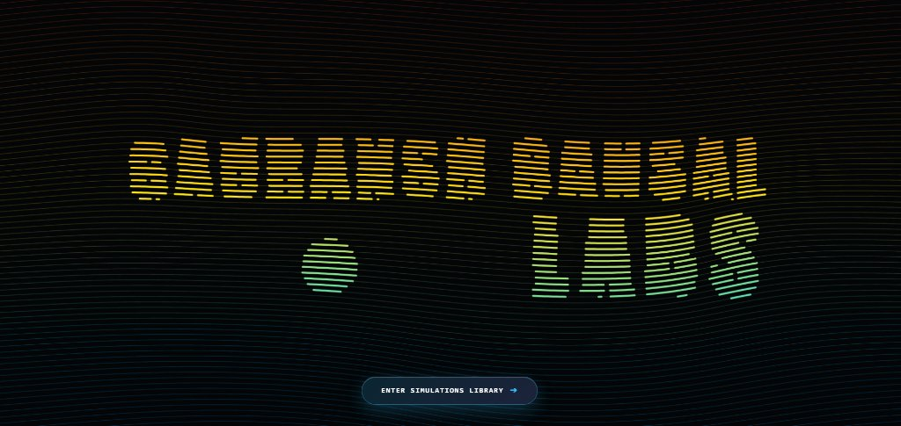
  </a>
</p>

### 🔮 [LUMOS: Molecular Spectroscopy Laboratory](lumos_molecular_spectroscopy.html)
> *A tactile first-person 3D quantum laboratory bridging physical intuition and molecular transitions.*

* **Launch Simulator:** [`lumos_molecular_spectroscopy.html`](lumos_molecular_spectroscopy.html)
* **Domain:** Quantum Chemistry, Molecular Spectroscopy, Microwave & Infrared Quantum Transitions
* **Core Mechanics:** First-person 3D alchemical laboratory where students wield a magical illumination wand to interrogate diatomic molecules ($^1\text{H}^{35}\text{Cl}$, $^1\text{H}^{79}\text{Br}$, $^1\text{H}^{127}\text{I}$, $^{12}\text{C}^{16}\text{O}$). Wield rotational microwave photons and vibrational IR quanta, trace potential energy wells ($V(r)$ Morse potential), unveil chalkboard derivations, decode Hedwig's experimental parchment scrolls, and solve the 4-compound archive vault puzzle.

<p align="center">
  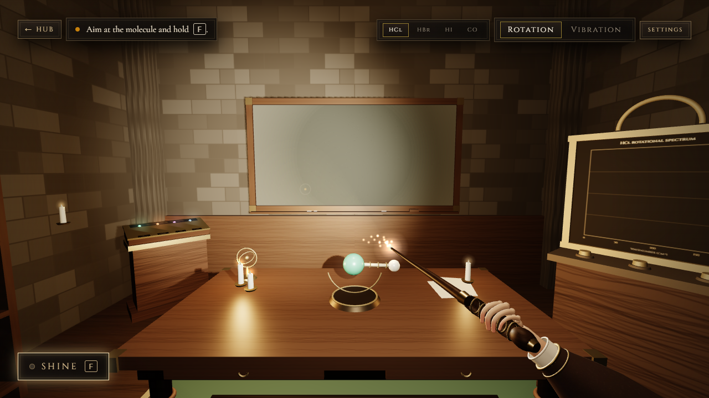
</p>

---

## 📖 The Story & Development Philosophy

This suite reflects a modern, **human-in-the-loop, AI-augmented scientific workflow**:

```text
┌───────────────────────────┐      ┌───────────────────────────┐      ┌───────────────────────────┐
│   Theoretical Rigor       │ ───► │  AI Algorithmic Scaffolding│ ───► │   Iterative Engineering   │
│ (Derivation, PDEs, ODEs)  │      │  (Google Antigravity / LLM│      │ (Convergence, Integrators)│
└───────────────────────────┘      └───────────────────────────┘      └───────────────────────────┘
                                                                                │
                                                                                ▼
┌───────────────────────────┐      ┌───────────────────────────┐      ┌───────────────────────────┐
│   Public Video Breakdown  │ ◄─── │   Tactile Glassmorphic UI │ ◄─── │   Physical Verification   │
│   (Scripted, Shot, Edited)│      │   (Interactive Canvas/Audio)│     │   (Boundary Conditions)   │
└───────────────────────────┘      └───────────────────────────┘      └───────────────────────────┘
```

1. **Rigorous Theoretical Grounding:** Every simulator begins with deep mathematical and physical derivations—whether deriving Navier-Stokes / Shallow Water approximations for outburst floods, modeling non-linear Lorenz attractor trajectories, or calculating Poisson/Gaussian radiation decay statistics.
2. **AI-Assisted Prototyping (Google Antigravity & Gemini):** I leverage Google Antigravity and Gemini for rapid scaffolding, generating mathematical translation layers and canvas rendering primitives.
3. **Multi-Pass Numerical & Physical Refinement:** From the initial scaffold, I iteratively refactor, stress-test, and tune numerical integrators (transitioning from naive Euler to symplectic Verlet and adaptive RK4), implementing boundary conditions, debugging phase drift, optimizing frame rates, and styling with a tactile glassmorphic design system.
4. **End-to-End Educational Communication:** For each simulator, I script, film, and edit a comprehensive video breakdown explaining the underlying physics and numerical mechanics, published on my **[LinkedIn profile](https://www.linkedin.com/in/gauransh-bansal-a71223239/)**.

> **💡 A Note on Authenticity vs. Academic Repositories:**  
> This repository represents a fusion of deep physics intuition with modern generative development. Unlike my **B.Sc. and M.Sc. physics repositories** (which were coded 100% natively by hand in C++, Fortran, Scilab, and Python), this project explores how a physicist can act as an **architect and orchestrator**—combining domain expertise with AI-assisted code generation to build complex, full-stack visual laboratories at high velocity without sacrificing mathematical rigor.

---

## 🧪 Visual Catalog & Laboratory Matrix

| # | Laboratory | Primary Domain | Underlying Mathematical Model | Interactive Canvas / Engine |
|---|------------|----------------|--------------------------------|-----------------------------|
| 01 | [**LUMOS Spectroscopy**](lumos_molecular_spectroscopy.html) | Quantum Chemistry | Morse Potential $V(r)$, Rotational/Vibrational Transitions | Three.js 3D First-Person |
| 02 | [**Same Equation, Different Reality**](same_equation_different_reality.html) | Universal Systems | $\ddot{x} + 2\gamma\dot{x} + \omega_0^2 x = F(t)$ across 4 Domains | Multi-Domain Canvas2D |
| 03 | [**The World of Capacitors**](unconventional_capacitors.html) | Electrostatics | Laplace/Poisson $\nabla^2 V = -\rho/\varepsilon$, Dielectric Bounds | High-Precision Field Plotter |
| 04 | [**Geiger-Müller Lab**](geiger_muller_laboratory.html) | Nuclear & Plasma | Townsend Avalanche, Dead Time, Poisson Statistics | Interactive Lab Apparatus |
| 05 | [**Chaos as Music**](chaos_as_music.html) | Dynamical Systems | Lorenz & Rössler Strange Attractors | Three.js + Web Audio Synth |
| 06 | [**Landscape of Futures**](lof.html) | Complexity & Chaos | Non-Linear Sensitivity & Divergent Manifolds | WebGL Particle Array |
| 07 | [**Phase Space Lab**](phase_space_lab.html) | Classical Mechanics | Hamiltonian Flow & Vector Field Topology | Vector Field Phase Trajectory |
| 08 | [**GLOF Simulator**](glacier_outburst_simulation.html) | Environmental Geophysics | Dam-Breach Hydraulics, 1D Shallow Water Waves | Terrain Profile & Flood Wave |
| 09 | [**ODE Numerical Methods**](ode_methods_simulator.html) | Computational Methods | Euler vs. Euler-Cromer vs. Verlet vs. RK4 | Real-Time Error Benchmark |
| 10 | [**Newton-Raphson Solver**](newton_raphson_simulator.html) | Numerical Analysis | $x_{n+1} = x_n - \frac{f(x_n)}{f'(x_n)}$, Fractal Basins | Dynamic Geometry & Basins |
| 11 | [**AETHERIA 2D Terrarium**](aetheria_terrarium_2d.html) | Emergent Life | Quadtree Flocking, Sinusoidal IK Leviathans | Canvas2D + Generative Audio |
| 12 | [**AETHERIA 3D Cosmos**](aetheria_cosmos_3d.html) | WebGL Simulation | Multi-Body N-Gravity Wells, Volumetric Stardust | Three.js Spatial Audio Engine |
| 13 | [**4D Manifold Projection**](manifold_4d_projection.html) | Differential Geometry | $SO(4)$ Rotation, Stereographic Hyperplane Projection | 4D Hypersurface Visualizer |

---

## 🏛️ The Five Laboratory Wings

### 🌌 Wing I: Quantum & Nuclear Phenomena

#### 1. 🔮 [LUMOS: Molecular Spectroscopy Laboratory](lumos_molecular_spectroscopy.html)
* **File:** [`lumos_molecular_spectroscopy.html`](lumos_molecular_spectroscopy.html)
* **Concepts:** Morse potential well, selection rules ($\Delta J = \pm 1$, $\Delta v = \pm 1$), rigid rotor, harmonic oscillator approximations, isotopic mass shifts ($^1\text{H}^{35}\text{Cl}$ vs. $^1\text{H}^{79}\text{Br}$).
* **Experience:** Cast light beams, solve the 4-vial archive puzzle, inspect Hedwig's field scrolls, and review interactive chalkboards.

#### 2. ☢️ [Geiger-Müller Virtual Physics Laboratory](geiger_muller_laboratory.html)
<p align="center">
  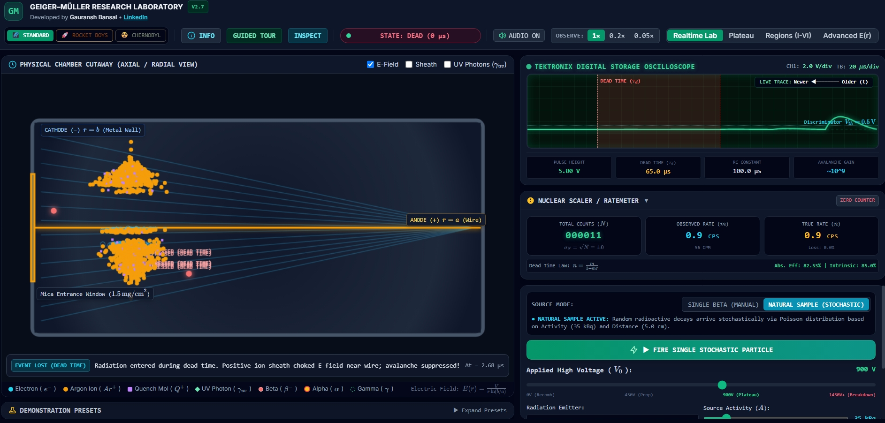
</p>

* **File:** [`geiger_muller_laboratory.html`](geiger_muller_laboratory.html)
* **Concepts:** Townsend avalanche multiplication, threshold voltage, Geiger plateau slope, continuous discharge breakdown, dead time ($\tau$) counting losses, inverse-square radiation propagation, and Poissonian pulse fluctuation statistics.
* **Breakdown:** Documented with video analysis on [LinkedIn](https://www.linkedin.com/in/gauransh-bansal-a71223239/).

---

### 🌀 Wing II: Nonlinear Dynamics, Chaos & Universal Systems

#### 3. ⚖️ [Same Equation, Different Reality](same_equation_different_reality.html)
<p align="center">
  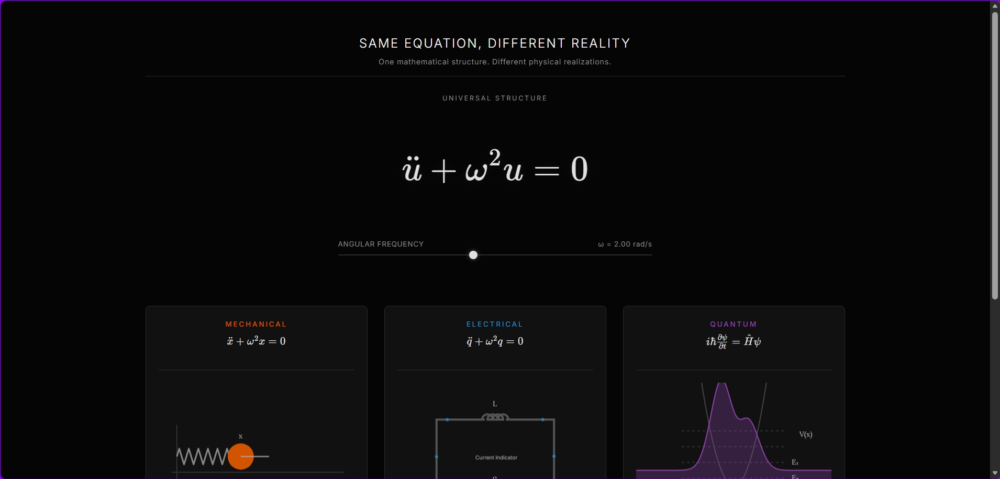
</p>

* **File:** [`same_equation_different_reality.html`](same_equation_different_reality.html)
* **Concepts:** Explores how a single second-order linear differential equation:
  $$\ddot{x} + 2\gamma\dot{x} + \omega_0^2 x = F(t)$$
  manifests identically across four completely distinct physical domains:
  1. **Classical Mechanics:** Damped, driven simple harmonic pendulum.
  2. **Electronics:** Series RLC circuit with alternating electromotive force ($L\ddot{q} + R\dot{q} + \frac{q}{C} = V(t)$).
  3. **Optics:** Lorentz electron oscillator model for dielectric dispersion.
  4. **Acoustics:** Helmholtz cavity resonator.
* **Breakdown:** Documented with video analysis on [LinkedIn](https://www.linkedin.com/in/gauransh-bansal-a71223239/).

#### 4. 🎵 [Chaos as Music & Nonlinear Attractors](chaos_as_music.html)
<p align="center">
  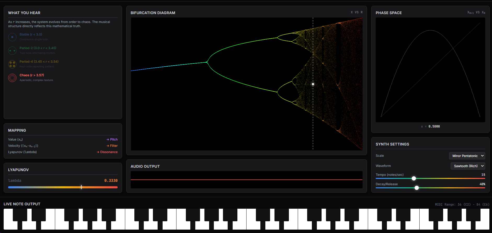
</p>

* **File:** [`chaos_as_music.html`](chaos_as_music.html)
* **Concepts:** Real-time numerical integration of the Lorenz Attractor ($\dot{x} = \sigma(y - x)$, $\dot{y} = x(\rho - z) - y$, $\dot{z} = xy - \beta z$) and Rössler systems. Translates continuous coordinates $(x, y, z)$ into pentatonic frequencies and synthesis parameters via the Web Audio API.
* **Breakdown:** Documented with video analysis on [LinkedIn](https://www.linkedin.com/in/gauransh-bansal-a71223239/).

#### 5. 🌀 [Phase Space Laboratory](phase_space_lab.html)
<p align="center">
  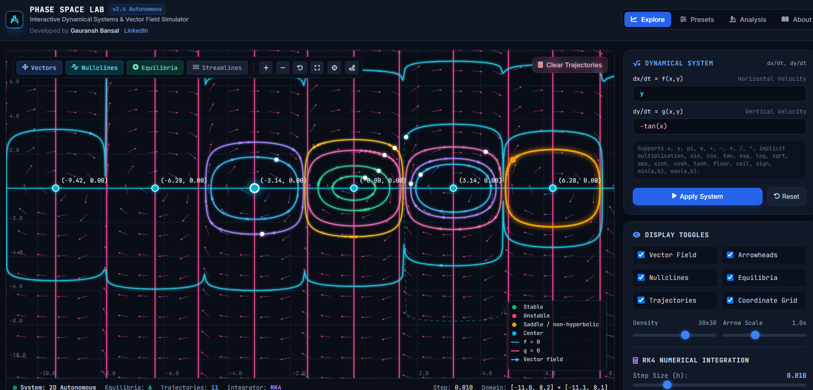
</p>

* **File:** [`phase_space_lab.html`](phase_space_lab.html)
* **Concepts:** Hamiltonian flows, conservative vs. dissipative phase portraits, Liouville's theorem (phase space volume preservation), Poincaré-Bendixson limit cycles, and interactive real-time vector field exploration.
* **Breakdown:** Documented with video analysis on [LinkedIn](https://www.linkedin.com/in/gauransh-bansal-a71223239/).

#### 6. 🌐 [Landscape of Futures (Chaos & Complexity)](lof.html)
<p align="center">
  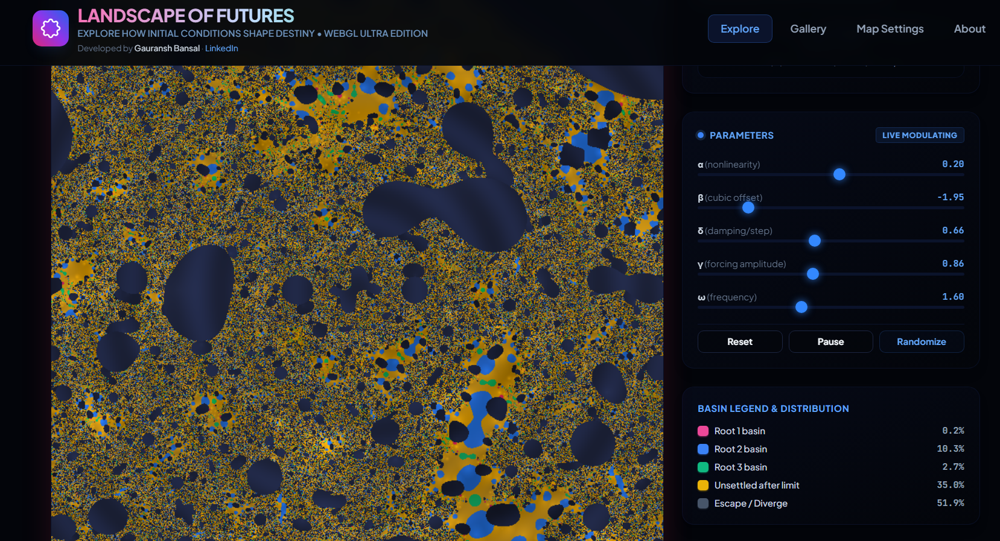
</p>

* **File:** [`lof.html`](lof.html)
* **Concepts:** Visual exploration of deterministic chaotic sensitivity, period-doubling cascades, and multi-agent divergent trajectories under microscopic initial perturbations.

---

### ⚡ Wing III: Electrodynamics & Environmental Geophysics

#### 7. ⚡ [The World of Capacitors](unconventional_capacitors.html)
<p align="center">
  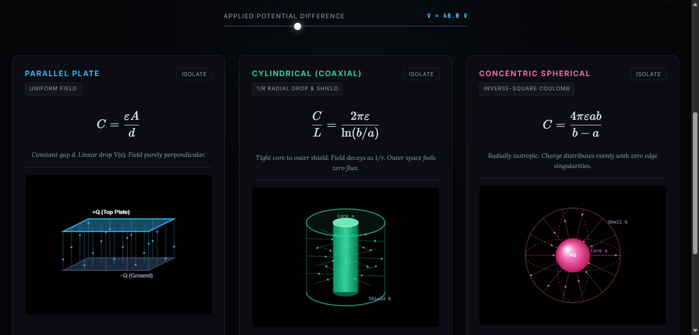
</p>

* **File:** [`unconventional_capacitors.html`](unconventional_capacitors.html)
* **Concepts:** From classic parallel plate, coaxial cylindrical, and concentric spherical capacitor models to unconventional geometries (fractal Sierpiński plates, variable-dielectric gradients, quantum dot capacitance). Features interactive field-line plotting, dielectric boundary conditions, and dielectric breakdown spark discharges.

#### 8. 🌊 [Glacial Lake Outburst Flood (GLOF) Simulator](glacier_outburst_simulation.html)
<p align="center">
  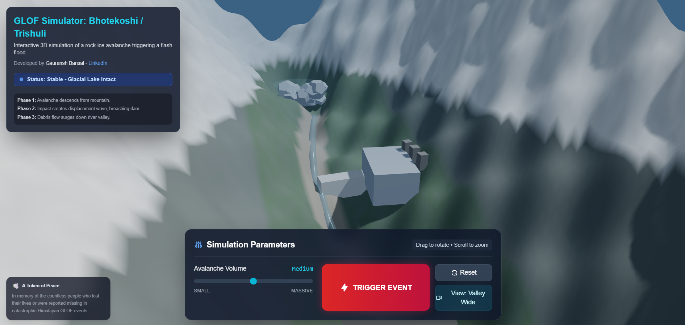
</p>

* **File:** [`glacier_outburst_simulation.html`](glacier_outburst_simulation.html)
* **Concepts:** Dam breach hydraulics, empirical erosion rate equations, 1D Saint-Venant shallow water hydrodynamics, sediment entrainment, flood hydrographs, and risk attenuation modeled along the *Trishuli River Valley* in the Himalayas.
* **Breakdown:** Documented with video analysis on [LinkedIn](https://www.linkedin.com/in/gauransh-bansal-a71223239/).

---

### 🌿 Wing IV: Generative Ecosystems & WebGL Cosmos

#### 9. 🌿 [AETHERIA: Living Digital Terrarium (2D Generative Life)](aetheria_terrarium_2d.html)
<p align="center">
  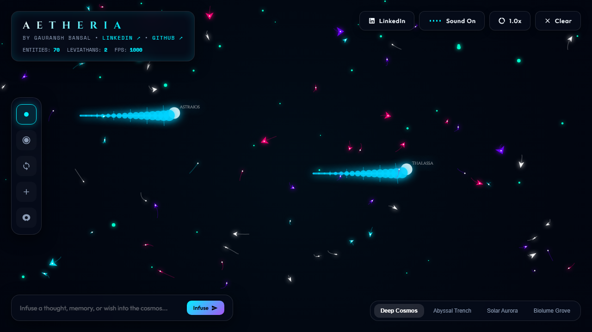
</p>

* **File:** [`aetheria_terrarium_2d.html`](aetheria_terrarium_2d.html)
* **Concepts:** Craig Reynolds' flocking boids accelerated with a spatial quadtree, neural apex predators with pursue-and-evade dynamics, multi-joint inverse-kinematics sinusoidal leviathans, nutrient spore lifecycles, and procedural Web Audio ambient soundscapes.

#### 10. 🌌 [AETHERIA 3D: The Infinite Cosmos](aetheria_cosmos_3d.html)
<p align="center">
  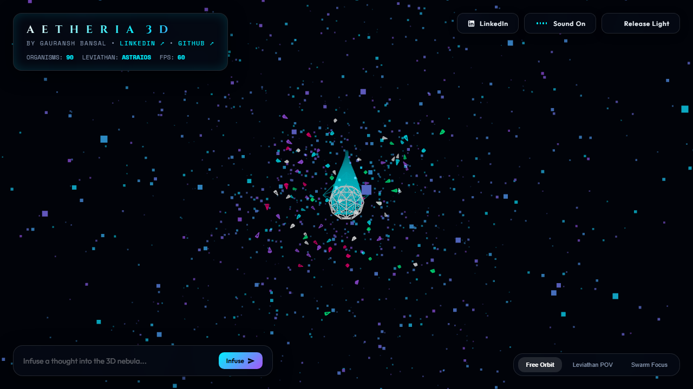
</p>

* **File:** [`aetheria_cosmos_3d.html`](aetheria_cosmos_3d.html)
* **Concepts:** Built in Three.js WebGL: 3D multi-body gravitational point attractors, volumetric particle dust clouds, celestial flocking swarms with 3D obstacle avoidance, luminous bloom shaders, and interactive orbital navigation.

---

### 📐 Wing V: Numerical Solvers & Differential Geometry

#### 11. 📐 [ODE Numerical Integration Methods Benchmark](ode_methods_simulator.html)
<p align="center">
  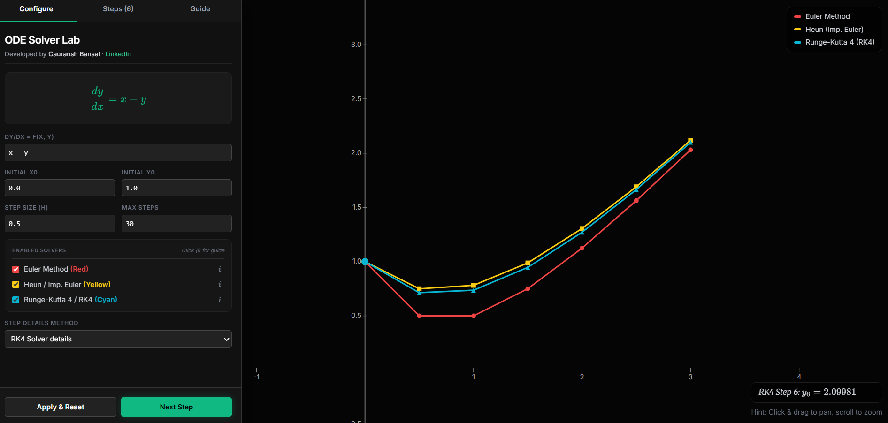
</p>

* **File:** [`ode_methods_simulator.html`](ode_methods_simulator.html)
* **Concepts:** Direct side-by-side benchmarking of numerical ODE integrators:
  - **Explicit Euler (1st order):** Fast but suffers from severe energy divergence.
  - **Euler-Cromer (Semi-implicit):** Conserves symplectic phase area for periodic systems.
  - **Verlet / Leapfrog (2nd order):** Time-reversible, ideal for orbital dynamics.
  - **Runge-Kutta 4th Order (RK4):** High precision with fourth-order global truncation error $O(\Delta t^4)$.
* **Breakdown:** Documented with video analysis on [LinkedIn](https://www.linkedin.com/in/gauransh-bansal-a71223239/).

#### 12. 🎯 [Newton-Raphson & Root-Finding Simulator](newton_raphson_simulator.html)
<p align="center">
  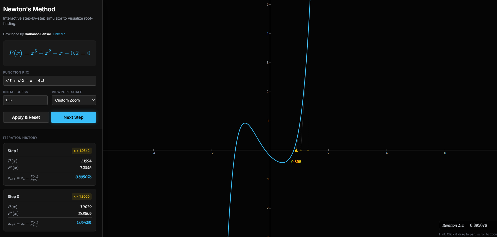
</p>

* **File:** [`newton_raphson_simulator.html`](newton_raphson_simulator.html)
* **Concepts:** Step-by-step tangent line construction:
  $$x_{n+1} = x_n - \frac{f(x_n)}{f'(x_n)}$$
  Visualizing quadratic convergence regimes, cycle traps, zero-slope inflection failures, and chaotic Julia/Fatou basin boundaries on the complex plane.
* **Breakdown:** Documented with video analysis on [LinkedIn](https://www.linkedin.com/in/gauransh-bansal-a71223239/).

#### 13. 🔮 [4D Manifold Projection & Relativistic Dynamics](manifold_4d_projection.html)
<p align="center">
  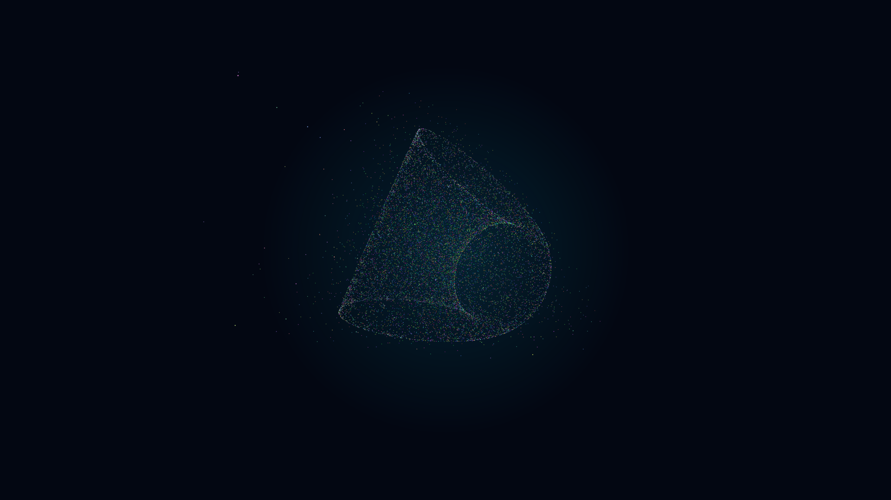
</p>

* **File:** [`manifold_4d_projection.html`](manifold_4d_projection.html)
* **Concepts:** Higher-dimensional differential geometry, stereographic projection from $\mathbb{R}^4 \to \mathbb{R}^3$, 4D double-rotations across orthogonal planes ($SO(4)$ Lie group), and relativistic geodesic particle paths.

---

## ⚙️ Computational Architecture & Tech Stack

```text
┌─────────────────────────────────────────────────────────────────────────────┐
│                       GAURANSH BANSAL LABS ARCHITECTURE                     │
├─────────────────────────────────────────────────────────────────────────────┤
│  Layer 1: User Experience  │ Tactile Glassmorphic Dark UI (Tailwind CSS)    │
│  Layer 2: Render Engines   │ Three.js WebGL (3D) & HTML5 Canvas2D (High-DPI)│
│  Layer 3: Physics & Solvers│ RK4, Symplectic Verlet, Euler-Cromer, Poisson  │
│  Layer 4: Sonification     │ Native Web Audio API Synthesizers              │
│  Layer 5: Portability      │ 100% Client-Side, Zero Dependencies, Zero Build │
└─────────────────────────────────────────────────────────────────────────────┘
```

* **Interactive String-Frame Wave Physics:** The entrance portal features a custom 2D harmonic wave-mesh and spring-damper string engine (`water-fluidity.js`) with Hooke's restoring tension, interactive cursor plucking/ripples on desktop, and autonomous organic ambient undulation on mobile devices.
* **High-Precision Solvers:** All engines run fully client-side at 60–120 FPS using requestAnimationFrame with delta-time clamping to prevent numerical explosion during background tab suspension.
* **Zero Dependency Philosophy:** Every simulation is a self-contained, standalone document requiring no Node.js runtime, no npm packages, and no compiler toolchain.

---

## 🚀 Running Locally

You can run the entire suite locally with any static web server:

```bash
# Clone the repository
git clone https://github.com/gauranshbansal/physics_simulations.git
cd physics_simulations

# Start a local static server
python -m http.server 8000
```

Open your browser at `http://localhost:8000` to launch the **[Gauransh Bansal Labs Gallery Hub (`index.html`)](index.html)**.

---

## 👤 About the Author & Connect

**Gauransh Bansal**  
*M.Sc. Physics — Department of Physics & Astrophysics, University of Delhi*  
*Specialization in Theoretical Physics, Computational Modeling & Visual Systems*

* **LinkedIn:** [linkedin.com/in/gauransh-bansal-a71223239](https://www.linkedin.com/in/gauransh-bansal-a71223239/)
* **GitHub:** [github.com/gauranshbansal](https://github.com/gauranshbansal)
* **Academic Portfolio:** [academicportfolio.pages.dev](https://academicportfolio.pages.dev)
* **Full Profile & Bio:** View [`about.html`](about.html) for more on my academic background and scientific work.

---

## 📄 License & Proprietary Notice

Copyright © 2026 Gauransh Bansal. All rights reserved.  
This software, physics simulation architectures, and accompanying educational media are proprietary intellectual property. See [`LICENSE`](LICENSE) for details.
